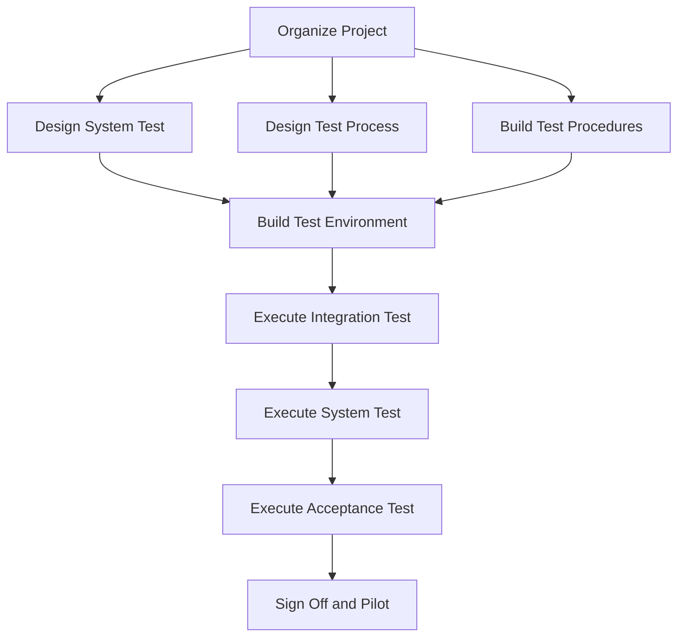

# MedPlus Test Plan Document

## Table of Contents
* [5. Introduction](#5-introduction)
* [5.1 Goals and Objective](#51-goals-and-objective)
* [5.2 Statement of Scope](#52-statement-of-scope)
  * [5.2.1 Major Constraints](#521-major-constraints)
    * [5.2.1.1 Software to be Tested](#5211-software-to-be-tested)
    * [5.2.1.2 Testing Strategy](#5212-testing-strategy)
    * [5.2.1.3 Unit Testing](#5213-unit-testing)
  * [5.2.2 Integration Testing](#522-integration-testing)
  * [5.2.3 Validation Testing](#523-validation-testing)
  * [5.2.4 High-Order Testing (System Testing)](#524-high-order-testing-system-testing)
    * [5.2.4.1 Recovery Testing](#5241-recovery-testing)
    * [5.2.4.2 Security Testing](#5242-security-testing)
    * [5.2.4.3 Performance Testing](#5243-performance-testing)
    * [5.2.4.4 Alpha/Beta Testing](#5244-alphabeta-testing)
* [5.3 Testing Resource and Staffing](#53-testing-resource-and-staffing)
* [5.4 Testing Procedure](#54-testing-procedure)
* [5.6 Test Record Keeping](#56-test-record-keeping)

---

## 5. Introduction
This document describes the testing requirements and test plan for the **MedPlus Pharmacy Point of Sale (POS) Management System**. The system is designed to meet the business needs of MedPlus Pharmacy—a community pharmacy operating in Nairobi, Kenya. The objective is to automate manual pharmacy operations, including sales transaction processing, real-time medicine inventory tracking (with expiry monitoring), prescription record verification, customer loyalty records, and business reporting, thereby facilitating accountability, efficiency, and customer satisfaction.

Testing is a major source of feedback and serves as a benchmark for ensuring the software is stable, secure, and compliant. Testing will be performed to verify that the system produces the desired results under various operating conditions. This test plan document identifies the software items to be tested, the testing environment, the test case design, and the test measurement techniques to be used.

The MedPlus Pharmacy POS system is designed to perform the following:
1. Process sales transactions for prescription and over-the-counter (OTC) medicines.
2. Manage real-time medicine inventory, tracking expiry dates and batches.
3. Record customer/patient profiles and track loyalty programs.
4. Manage prescription records and enforce compliance by linking prescriptions to sales of prescription-only (Rx) medicines.
5. Record suppliers and handle supply chain workflows via purchase orders.
6. Provide role-based user access controls (Admin, Pharmacist) with dynamic permission updates.
7. Support modern payment interfaces, including Cash, Card, and M-Pesa STK push callbacks via Safaricom Daraja API.
8. Generate daily, weekly, monthly sales reports, low-stock alerts, expiring stock reports, and profit-margin summaries.
9. Automatically backup data and log system audit trails.

Testing criteria will be utilized under the white-box, black-box, and system testing paradigms to ensure code correctness and operational compliance.

---

## 5.1 Goals and Objective
The main goal of testing is to compile a detailed document that will be used by developers and QA personnel to verify that the MedPlus system performs in accordance with the specifications in the System Requirements Specification (SRS) document.

The objectives of the system testing include:
1. **Defect Identification:** Uncover errors, bugs, security vulnerabilities, and failures in the database schema, API routing, and web UI.
2. **Test Case Standardization:** Establish reusable test cases and test data representing realistic pharmacy scenarios (e.g., dispensing expired stock, checking out Rx drugs without prescriptions).
3. **Resource Optimization:** Allocate testing resources (hardware, servers, testers, network setups) efficiently.
4. **Schedule Alignment:** Establish a structured testing timeline across the different phases of unit, integration, validation, and system testing.
5. **Requirement Verification:** Ensure all functional and non-functional requirements (including response times, uptime, database security, and compliance with the Pharmacy and Poisons Board of Kenya regulations) are met.
6. **Usability Assessment:** Verify that the frontend web interfaces are intuitive, clear, and easy to use by pharmacy administrators and pharmacists.
7. **System Consistency:** Ensure that database transactions adhere to ACID properties and that state management remains consistent during peak workloads or concurrent operations.

---

## 5.2 Statement of Scope
The scope of testing covers the end-to-end functionality of the MedPlus Pharmacy POS system. This includes the client interface (served dynamically from the `/web` directory), the Go backend API application, database queries, and third-party integrations (PostgreSQL data structures, local configurations, and the Safaricom Daraja API for M-Pesa STK pushes).

### 5.2.1 Major Constraints
The testing process is constrained by several environmental, technical, and external factors:
1. **Network Dependencies:** The M-Pesa payment integration relies on external callbacks from the Safaricom Daraja API. Testing requires mock callback payloads or sandbox endpoint availability.
2. **Platform Portability:** The system must run reliably across different operating systems (Windows 10/11 for local pharmacy computers, and Linux for Docker containers and staging environments).
3. **Database Availability:** Testing relies on a persistent connection to PostgreSQL. A database connection pool failure or local server downtime will suspend backend validation.
4. **Hardware Interfaces:** Testing point-of-sale peripherals, such as physical USB barcode scanners and 80mm thermal receipt printers, requires physical devices or simulated inputs.

#### 5.2.1.1 Software to be Tested
The software system under test is the **MedPlus Pharmacy POS Management System**, which consists of:
* **Backend API Application:** Written in Go, exposing RESTful endpoints under `/api/*` for authentication, inventory, customers, prescriptions, sales, supply chain, payments, and reports.
* **Frontend SPA Web Client:** A web interface built using HTML5, Vanilla CSS, and JavaScript, communicating with the Go backend.
* **Database Layer:** PostgreSQL relational database schemas, indexes, checks, and foreign key relationships.

#### 5.2.1.2 Testing Strategy
The testing workflow is structured incrementally to isolate errors efficiently:
1. **Unit Testing:** Focuses on testing individual modules, functions, input fields, and database queries in isolation.
2. **Integration Testing:** Evaluates the interaction between combined software units, such as Go handler routing, database queries, and third-party API communication.
3. **Validation Testing:** Checks that the system functions in a manner that the pharmacy end users expect, validating workflows from the point of view of the pharmacist and administrator.
4. **High-Order (System) Testing:** Validates the system as a whole, including performance, security, data recovery, and user acceptance.

#### 5.2.1.3 Unit Testing
Unit testing is the first phase, focusing on verifying the inputs, output logic, and interface designs of individual fields and pages before integration.

| Type of Test | Area Being Tested | Expected Output | Actual Outcome | Incorrect Outcome |
| :--- | :--- | :--- | :--- | :--- |
| **Unit Test: Inputs** | Password Field | Asterisk masking (`••••••••`); minimum 8 characters; must be securely hashed using bcrypt. | Password characters masked; rejects simple/short passwords. | Characters shown in plaintext; allows weak passwords; plaintext saved in DB. |
| | Username Field | Alphanumeric; must be unique; cannot be left blank. | Accepts unique username; redirects to error state if username exists. | Allows empty string; allows duplicate usernames, overwriting data. |
| | User Category (Role) | Accepts explicit predefined values: `Admin`, `Pharmacist`. | Role validated on creation; dynamic access assigned accordingly. | Rejects valid role; accepts arbitrary roles (e.g., `Guest`), granting access. |
| | M-Pesa Phone Number | Valid Kenyan phone format: `2547XXXXXXXX` or `2541XXXXXXXX` (12 digits starting with 254). | Rejects invalid phone numbers; format validated prior to STK push request. | Accepts short, long, or non-Kenyan phone formats, leading to API failures. |
| | Numeric Fields (Price/Qty) | Non-negative integer values for stock levels; positive decimal numbers for prices. | Rejects negative stock quantities and negative unit prices. | Accepts negative stock/price, creating corrupted transaction values. |
| | Date Fields (Expiry Date) | Valid date format `YYYY-MM-DD`. Expiry date must be set in the future for new products. | Rejects invalid formats (e.g. `MM-DD-YYYY`) and past dates for fresh stock. | Allows past dates for incoming stock; allows invalid dates (e.g. `Feb 31`). |
| | Alphabetic Fields (Names) | Supports standard letters, spaces, and punctuation for product, customer, and supplier names. | Validates names; truncates or rejects overly long strings exceeding DB limit. | Rejects valid names with accents; allows code snippets (SQL injection risk). |
| | Indexed Fields (Barcodes) | Barcode inputs (UPC-A, EAN-13, etc.) must match exact alphanumeric formats. | Unique index verified; database prevents duplicate barcodes. | Allows duplicate barcodes; slow search query times due to missing index use. |
| **Screen Design** | Web UI Layout | Responsive grid layouts adapting to standard desktop/tablet resolutions; legible font size. | Layout aligns correctly; clear navigation sidebar showing authorized menus. | Elements overlap on small screens; menus visible to unauthorized roles. |
| **Output Design** | Receipt & Reports | Clean tabular display of sales receipts, profit analyses, and printable layout structures. | Reports printed in clear formats; exports to CSV and PDF are well-formatted. | Displaced columns on print; report numbers miscalculated or cut off. |
| **Database Storage** | PostgreSQL Save | Successful database writes with correct field assignments and timestamps. | Data stored correctly in respective tables (users, products, sales, etc.) | Data truncation; null values written to NOT NULL columns, causing crashes. |

---

## 5.2.2 Integration Testing
Integration testing verifies that the individual units of the system—such as the Go handlers, middleware validation, database layer, and Safaricom API integration—work together seamlessly.

* **Functional requirements validated during integration testing include:**
  1. **Session & Middleware Integration:** Enforcing token-based authentication (JWT extraction, validation, and user role extraction) on private routes.
  2. **Inventory Stock Adjustment:** Automated inventory deduction upon sale processing (applying FIFO logic when multiple batches exist).
  3. **Prescription-Sales Linkage:** Verifying that checking out prescription-only (Rx) medicines requires a valid prescription record ID in the request payload.
  4. **Purchase Order Stock Receipt:** Automated stock quantity increment in `products` table once a draft purchase order status is updated to `received`.
  5. **M-Pesa Payment Status Sync:** Safaricom callback payload matching and updating the correct transaction record status from `pending` to `completed` or `failed` in the database.

| Type of Test | Area Being Tested | Expected Outcome | Actual Outcome |
| :--- | :--- | :--- | :--- |
| **Integration Test** | Entity Relationships | Database foreign keys enforce integrity. Deleting a product/customer is restricted if they have active transaction records. | Foreign key constraints raise appropriate errors, preventing database orphaned records. |
| | Sales & Inventory Sync | Processing a sale of 5 units of "Ibuprofen" updates stock in `products` table from $N$ to $N - 5$. | Stock quantity is automatically decremented inside a database transaction. |
| | Prescription Enforcement | Processing a sale containing Rx drugs without an associated `prescription_id` yields a validation error. | Backend rejects checkout payload with a `400 Bad Request` explaining prescription is required. |
| | Supplier & PO Receipt | Receiving purchase order updates the status of the PO to `received` and increments product inventory. | Inventory increments automatically by the received quantity; database logs the receiving user ID. |
| | M-Pesa API Callbacks | Safaricom callback webhook parses checkout IDs, matches them with `mpesa_payments`, and updates transaction status. | Database records payment status as `completed`, registers the M-Pesa receipt number, and commits. |
| | Report Aggregations | Reports query database records, group sales by categories, filter by date ranges, and calculate total revenues. | The report endpoints aggregate values correctly, matching manual sums of completed transactions. |

---

## 5.2.3 Validation Testing
Validation testing (high-order workflow testing) ensures that the application behaves exactly as expected by the end-user (pharmacist or admin) across all primary functional modules.

| Type of Testing | Area Being Tested | Expected Outcome | Actual Outcome |
| :--- | :--- | :--- | :--- |
| **Validation Testing** | **Authentication Modules** | | |
| | User Login | Users enter credentials. Valid attempts redirect to the dashboard; invalid attempts show user-friendly errors. | Authentication handler checks bcrypt hash, issues a JWT, and stores session variables. |
| | Token Authorization | System logs out inactive users after 30 minutes; block access if the authorization token is expired. | Middleware intercepts requests, invalidates expired sessions, and prompts re-login. |
| | **Inventory Modules** | | |
| | Add Medicine Module | Easy-to-use form to add new products, including name, category, barcode, price, stock, expiry date, and reorder level. | Database inserts new record. Product immediately appears in POS inventory searches. |
| | Update Stock Module | Modifies stock quantities, brand name, price, and expiry date details. | Changes saved and propagated to database; audit log registers update event. |
| | Deactivate Module | Deactivates (soft deletes) discontinued medicines rather than removing records permanently. | Product status flag set to `inactive`. The product is hidden from POS searches but preserved in logs. |
| | Low Stock Warnings | System monitors stock level. Generates indicators or alerts when stock falls below the configured reorder level. | Sidebar displays red warning flags; low-stock reports list items. |
| | Expiry Date Alerts | System flags medicines expiring within 30 days and prevents pharmacists from selecting them in POS. | Alert banner warns the user; system locks checkout actions for expired items. |
| | **Sales & POS Modules** | | |
| | Cart & Search Module | Allows searching by barcode or generic name, adding items to cart, adjusting quantities, and applying discounts. | Cart recalculates subtotals, tax, and final amount in real time on the client side. |
| | Cash Payment | Enter cash received, calculate change, save transaction as `completed`, print thermal receipt, and open cash drawer. | Database records sale status as `completed`, resets checkout form, and triggers printer. |
| | M-Pesa STK Push | Triggers STK push to customer mobile phone. Enters transaction into `pending` state awaiting Safaricom callback. | STK push popup sent to phone. System polls callback status; changes to `completed` upon PIN entry. |
| | **Prescription Modules** | | |
| | Create Prescription | Pharmacist enters patient name, prescriber details, and lists Rx medicines. Generes a unique prescription ID. | Record written to `prescriptions` and `prescription_items` tables; links to customer ID. |
| | Link to POS Cart | Pharmacist enters prescription number in checkout screen. System verifies and imports Rx medicines to cart. | Validates prescription number, auto-populates cart with prescribed items, and links prescription ID. |
| | **Supply Chain Modules** | | |
| | Create Purchase Order | Selects supplier, adds items to order, saves draft, and submits order to supplier. | Purchase order status changed to `submitted`; records expected delivery date. |
| | Receive PO Stock | Matches delivered products against PO items, updates received quantities, and updates products inventory. | System marks PO as `received`, updates database, and increases stock levels. |
| | **Analytics & Reports** | | |
| | Sales Report Module | Filters completed sales by date ranges (daily, weekly, monthly) to display total revenue, tax collected, and transactions. | Displays detailed summary list and bar charts; exports records to CSV/Excel. |
| | Profit Margin Module | Subtracts buying cost from selling price across transactions to compute gross margins. | Reports display actual profit margins by product category and time period. |

---

## 5.2.4 High-Order Testing (System Testing)
System testing validates the completely integrated application, checking that it meets security, data recovery, load processing, and general configuration criteria.

Below is the status of key system components verified during system testing:

| Test Component | Status | Recommendation |
| :--- | :--- | :--- |
| **Login Form** | PASS | Authenticates users correctly. Ensure password fields hide characters and enforce strong password policies. |
| **Register User Form** | PASS | Creates system accounts. Limit self-registration features via environment variable `ENABLE_PUBLIC_REGISTRATION=false` in production. |
| **Dashboard / Stats** | PASS | Aggregates summary sales data, low stock counts, and expiring items. Use caching for database queries on heavy data. |
| **Inventory Interface** | PASS | Handles updates, filtering, and deactivations. Enforce strict decimal input validations on price fields. |
| **Point of Sale (POS) Interface** | PASS | Facilitates cart management, barcode scanning, and discounts. Store cart state in local storage to prevent data loss on browser refresh. |
| **Checkout & Payments** | PASS | Handles Cash, Card, and M-Pesa payment configurations. Require pharmacist confirmation prior to completing transactions. |
| **M-Pesa STK Callback Handler** | PASS | Webhook endpoint processes Safaricom callbacks and updates payment records. Implement signature validation or IP range restrictions. |
| **Customer Profiles Form** | PASS | Records loyalty numbers and contact details. Validate phone numbers using standard regex formats. |
| **Prescriptions Module** | PASS | Records doctors and patients, linking Rx items. Enforce checking prescription numbers on checkout of Rx categories. |
| **Suppliers & PO System** | PASS | Drafts, submits, and receives inventory orders. Warn user if received quantities exceed ordered quantities. |
| **Reports & Excel Export** | PASS | Exports sales and stock reports. Restrict heavy reports requests to off-peak hours or enforce date-range limits (max 31 days). |
| **RBAC Permissions Panel** | PASS | Dynamically updates user access permissions. Admin role should be protected from accidental deactivation or self-demotion. |

---

### 5.2.4.1 Recovery Testing
Recovery testing evaluates the system's ability to maintain data integrity and recover gracefully from sudden server, database, or network crashes.

1. **Go Server Crash Recovery:**
   * *Test:* Kill the Go backend process during an active checkout API call.
   * *Result:* The database transactions must roll back. Client receives a standard gateway error (or reconnects when the server restarts).
   * *Recovery Validation:* On restarting the Go executable, verify database connectivity is restored automatically, database pools are rebuilt, and incomplete transactions show no partial writes.
2. **PostgreSQL Connection Lost Recovery:**
   * *Test:* Terminate the PostgreSQL database service while the Go backend is running.
   * *Result:* Backend logging registers connection loss. Accessing APIs returns `503 Service Unavailable` with details logged.
   * *Recovery Validation:* Once PostgreSQL service starts again, backend pinging logic (invoked via `/api/ready`) detects reconnect and queries succeed without requiring a server reboot.
3. **M-Pesa Webhook Callback Recovery:**
   * *Test:* Simulate Safaricom sending an STK callback while the MedPlus server is offline.
   * *Result:* Safaricom logs delivery failure. The transaction remains in `pending` state in `mpesa_payments`.
   * *Recovery Validation:* Admin dashboard allows manual status checks by querying Safaricom API `/api/payments/mpesa/status/{checkoutRequestId}` to resolve pending statuses.

---

### 5.2.4.2 Security Testing
Security testing ensures the application protects pharmacy data, locks unauthorized access, and guards against security exploits.

1. **Role-Based Access Control (RBAC):**
   * Verifies that pharmacists cannot access `/api/admin/*` or `/api/reports` routes unless explicitly granted by Admin permissions.
   * Attempting to access admin endpoints returns a `403 Forbidden` JSON response.
   * Admin panel allows dynamic role-permission changes stored in the `role_permissions` table.
2. **Authentication & Session Management:**
   * Passwords are encrypted using bcrypt hashing before storage. Plaintext passwords are never logged or stored.
   * JWT tokens are signed using a secure algorithm and verified on each request.
   * Accounts are locked for 15 minutes after 5 consecutive failed login attempts to prevent brute-force attacks.
3. **Database Security & Input Validation:**
   * All SQL statements use parameterized placeholders (e.g. `$1, $2`) supported by the `pq` Go library, preventing SQL injection.
   * Input strings are sanitized on the backend and escaped on the frontend to prevent Cross-Site Scripting (XSS).
   * Cross-Origin Resource Sharing (CORS) is configured explicitly, restricting API access to registered domains in production.

---

### 5.2.4.3 Performance Testing
Performance testing evaluates response times, concurrency limits, and database execution speeds.

1. **API Response Latencies:**
   * Under normal workloads (up to 5 concurrent pharmacist terminals), responses for product lookups, barcode identification, and cart checkouts must resolve in under 1.5 seconds.
   * Database queries are optimized using index tables on frequently searched fields:
     * Barcode checks: `idx_products_barcode` on `products(barcode)`
     * Category filters: `idx_products_category` on `products(category)`
     * Transactions: `idx_sales_transaction_id` on `sales(transaction_id)`
2. **Concurrency Load Testing:**
   * Enforce database connection limit configurations (`DB.SetMaxOpenConns(25)`) to manage hardware resource consumption on the PostgreSQL container.
   * The Go backend handles requests concurrently using Goroutines, ensuring thread safety and preventing database locks.

---

### 5.2.4.4 Alpha/Beta Testing
Prior to full deployment, testing is conducted by MedPlus Pharmacy staff in two phases:

1. **Alpha Testing (Internal):**
   * Conducted by developers and the QA team in a staging environment using seeded demo data.
   * Verifies basic flows, API edge-cases, error message handling, and page response behaviors.
2. **Beta Testing (User Acceptance Testing):**
   * Conducted by MedPlus Pharmacy staff (Admins and Pharmacists) in the actual operating environment.
   * Staff register transactions, scan test barcodes, trigger test M-Pesa STK pushes (Sandbox mode), and export generated sales reports.
   * Feedback is gathered regarding interface usability, receipt print alignments, and system speed.

---

## 5.3 Testing Resource and Staffing
The execution of this test plan requires the coordination of hardware, software, and human resources:

### Hardware Requirements:
* **Server/Workstation:** Minimum Intel Core i3 Processor, 4GB RAM, 256GB storage space.
* **Point-of-Sale Hardware:** USB Barcode Scanner (supporting EAN-13 barcodes), 80mm USB thermal receipt printer.
* **Testing Devices:** Mobile phone with active M-Pesa line for validating STK pushes.

### Software Requirements:
* **Operating System:** Windows 10/11 or Ubuntu Linux.
* **Database Management System:** PostgreSQL 13 or higher.
* **Development Environment:** Go 1.20+, web browsers (Chrome/Firefox/Edge latest versions).

### Staff Roles & Training Validation:
* **QA Tester:** Responsible for running test scripts, verifying API endpoints, and documenting system bugs.
* **Pharmacy Administrator:** Tests user account setups, database backup checks, and role permission updates.
* **Pharmacist:** Verifies medicine inventory creation, expiry date alert thresholds, and prescription recording workflows.
* **Pharmacist:** Tests POS cart creation, barcode scanning speed, receipt print commands, and payment collection.

| Type of Test | Area of Interest | Expected Results | Actual Results |
| :--- | :--- | :--- | :--- |
| **Acceptance Testing** | Training | End users receive 2 hours of system training. | Pharmacists are able to use the system independently. |
| | User Manual | Documentation covers user login, product creation, cart checkout, and reporting steps. | Users find instructions clear and successfully perform daily operations. |

---

## 5.4 Testing Procedure
The testing lifecycle follows a structured sequence of actions. Below is the workflow representing the testing procedure:

### Procedure Details:
1. **Organize Project:** Establish scope, identify dependencies, assign testers, and schedule milestones.
2. **Design System Test / Test Process:** Identify test cycles, write edge-case scenarios, and format test data arrays.
3. **Build Test Procedures:** Create automated tests (Go unit testing files `*_test.go`), script manual checklists, and define status reporting structures.
4. **Build Test Environment:** Install PostgreSQL, compile Go backend binaries, set up environment files (`.env`), and connect POS barcode scanners and receipt printers.
5. **Execute Integration Test:** Test the interaction between modules (e.g., verifying database constraints, checking CORS middleware logic, mocking third-party APIs).
6. **Execute System Test:** Perform stress tests, force network failures for recovery checks, run authorization bypass checks, and test receipt layouts.
7. **Execute Acceptance Test:** Train pharmacy staff, evaluate user interaction, verify PDF documentation exports, and resolve usability issues.
8. **Sign Off and Pilot:** System is formally approved, final databases are initialized, and the system is deployed live at MedPlus Pharmacy.

---

## 5.6 Test Record Keeping
To track testing progress and ensure all issues are resolved, a detailed test logging process is maintained:
1. **Defect Tracking:** Found defects must be recorded in an issue tracking sheet, specifying the module, description, severity, status, and developer assigned.
2. **System Log Files:** Go backend errors and panic logs are captured and written to system files (`server.log`) for debug review.
3. **Database Audit Trails:** Security-critical events (login failures, user deactivations, payment adjustments) are logged directly in user activity records to ensure compliance and traceability.
4. **Sign-off Report:** A summary report documenting final test results, unresolved low-priority issues, and performance metrics is archived for design references.
